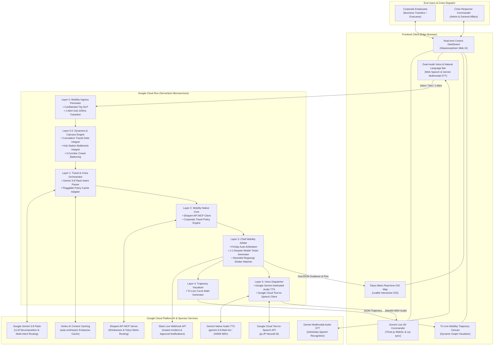

# ResiliRoute v3.3 - System Architecture Specification

## 1. High-Level Architecture Overview

ResiliRoute is an Enterprise Mobility FinOps Governance & Earthquake BCP Crowd-Balancing Engine deployed on **Google Cloud Run**. It seamlessly bridges daily corporate travel cost optimization with sub-100ms emergency crisis response.

---

## 2. Mathematical Models & Core Algorithms

### 2.1 Layer 0.5: Cumulative Transit Debt Integral
Measures employee business travel fatigue debt over a rolling 10-day window:
$$D_{\text{transit}}(t) = \int_{t-10}^{t} \left[ \sum_{i} H_i \cdot w_{\text{late}} \cdot e^{-\lambda(t - \tau_i)} \right] d\tau$$
* If $D_{\text{transit}} > 15.0$ hours, automated policy exception elevates seat upgrade rights.

### 2.2 Layer 0.5: Station Bottleneck Integral & Shutdown Criterion
Calculates crowd congestion pressure at critical transport hubs (e.g. Shinjuku Station):
$$B(t) = \frac{\int_{0}^{t} \left( \Phi_{\text{in}}(\tau) - C_{\text{evac}}(\tau) \right) d\tau}{S_{\text{max}}}$$
* If $B(t) \ge 0.70$: Instant automatic perimeter shutdown issued to prevent station crush disasters.

### 2.3 Layer 0.5: 3-Corridor Crowd-Balancing Optimization
Allocates $N = 120$ headquarters personnel into 3 safe evacuation corridors:
* **Group A (40 pax)**: Meiji Jingu Green Path (Avoids rail concourse)
* **Group B (40 pax)**: Shinjuku Gyoen National Garden
* **Group C (40 pax)**: Hatsudai Secondary Highway & Bus Hub
Each employee receives an individualized 1:1 mobile guidance ticket with QR verification token.

---

## 3. Technology Stack & Hackathon Requirements Mapping

| Layer / Component | Technology Used | Hackathon Criteria Met |
| :--- | :--- | :--- |
| **Execution Environment** | Google Cloud Run (asia-northeast1) | **Requirement 1**: Google Cloud Serverless Container |
| **Generative AI** | Google Gemini 3.8 Flash | **Requirement 2**: Gemini API / Vertex AI |
| **Voice AI (TTS)** | Gemini 3.8 Flash Native TTS + Cloud TTS | **Requirement 2**: Text-to-Speech AI |
| **Voice AI (STT)** | Gemini Multimodal Audio STT | **Requirement 2**: Speech-to-Text AI |
| **Context Memory** | Vertex AI Context Caching ($0.00 zero-cost) | **Requirement 2**: Vertex AI Enterprise Agent Platform |
| **Data Privacy** | Cloud DLP (Confidential Trip Sanitizer) | **Requirement 2**: Natural Language / Security AI |
| **Mobility Sponsor API** | **Ekispert API MCP Server** | **Requirement 3**: Sponsor Specialized Tech (Top Priority) |
| **Frontend Framework** | Three.js (WebGL 3D), Leaflet GIS, Canvas 2D | Interactive Visual UI & Real-time Telemetry |
