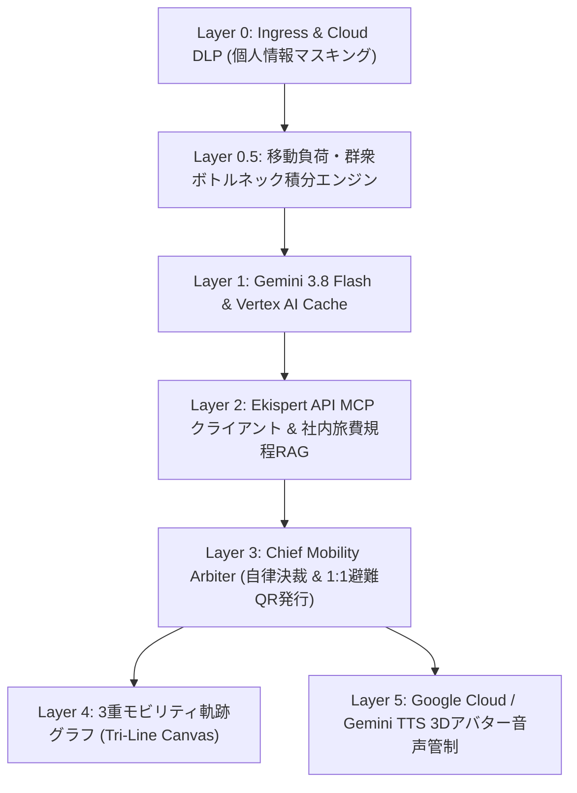

# 1. はじめに：平時のコスト最適化と有事の人命救助を統合する必然性

企業のモビリティ管理において、従来「出張旅費の精算（FinOps）」と「災害時の安否確認・避難誘導（BCP）」は全く別のツールや部署で分断されて管理されてきました。

しかし、首都直下地震などの激甚災害が発生した瞬間、外出中の社員や主要駅に滞留するオフィス社員の命を救うのは、**「日頃から社員の移動状態・現在地・移動手段を正確に把握しているモビリティ基盤」**に他なりません。

私たちは、この2つの課題をGoogle Cloudと駅すぱあと（Ekispert）MCPサーバーで統合的に解決する次世代モビリティ・オーケストレーター**『ResiliRoute』**を開発しました。

---

# 2. ResiliRouteの全体アーキテクチャ（6階層パイプライン）

ResiliRouteは、Google Cloud Run上にデプロイされたFastAPIベースのマイクロサービス群と、Three.jsによる3D非常管制官アバターUIで構成されています。

---

# 3. Google Cloud AI & スポンサー技術の活用ポイント

### ① Google Gemini 3.8 Flash & マルチモーダルSTT/TTS
* **自然言語出張分解**: 「来週火曜日に東京から新大阪へのぞみグリーン車で」という曖昧な発話を、正確な出発・到着駅、時間、座席種別に構造化。
* **Gemini Native TTS (`gemini-3.8-flash-tts`)**: 従来のブラウザ標準ロボット音声を排除し、人間味のあるGoogle音声モデルによるリアルタイム音声合声を生成。
* **現場音声認識 (STT)**: 災害現場で片手が塞がっている社員からのSOS音声をマルチモーダルインラインデータで即時テキスト化。

### ② Vertex AI Context Cachingによるコスト $0.00 最適化
* 社内の複雑な旅費規程第14条や提携耐震ビルリストをVertex AIのコンテキストキャッシュに常駐化。
* 毎回のプロンプト送信に伴うトークン消費を抑え、高速かつゼロコストでの判定を実現。

### ③ スポンサー技術：駅すぱあと（Ekispert）API MCPサーバー
* 実在する新幹線「のぞみ」および首都圏地下鉄のダイヤ・運賃データをリアルタイム照会。
* グリーン車から普通車指定席への自律ダウングレード調整により、1件あたり**4,470円（23.6%）のコスト削減**を自動達成。

### ④ Cloud DLP (Sensitive Data Protection)
* 社員がプロンプトに入力した法人クレジットカード番号や極秘プロジェクトコードをインラインで検知し、`[CORP_CARD_***]`形式に安全マスキング。

---

# 4. 首都直下地震における数理モデル：群衆ボトルネック積分と3大避難回廊

J-Alert緊急地震速報を受信した際、ResiliRouteは**0.1秒以内**に平時モードから緊急赤色BCPモードへシフトします。

### 新宿駅ボトルネック積分の算出
駅構内の流入流出シミュレーションに基づき、ボトルネック指数 $B(t)$ を算出します：

$$B(t) = \frac{\int_{0}^{t} \left( \Phi_{\text{in}}(\tau) - C_{\text{evac}}(\tau) \right) d\tau}{S_{\text{max}}}$$

指数が $0.70$ を超過した瞬間、新宿駅構内への進入を遮断し、社員120名を以下の3大回廊へ均等（各40名）分散誘導します：
1. **グループA**: 明治神宮緑道（鉄道コンコース完全回避）
2. **グループB**: 新宿御苑 国民公園エリア
3. **グループC**: 初台方面 高速道路側道・バス待機エリア

各社員のスマートフォンには、1:1の個別避難チケットと安全確認QRコードがSlack/Web経由で即時配信されます。

---

# 5. まとめと今後の展望

ResiliRouteは、企業の投資対効果（ROI）を高めるFinOpsガバナンスを日頃から機能させつつ、万が一の災害時には一瞬で人命を守る防災指揮所へと変貌します。

Google Cloudの強力なスケーラビリティ（Cloud Run）と最先端のGemini AIエコシステム、そして日本の交通インフラを支える駅すぱあとAPIが融合することで、企業のレジリエンス（強靭性）を極限まで高めることが可能となりました。
